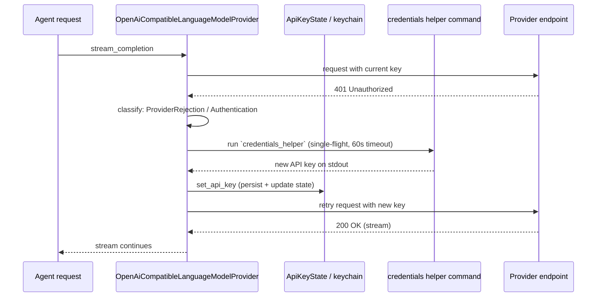
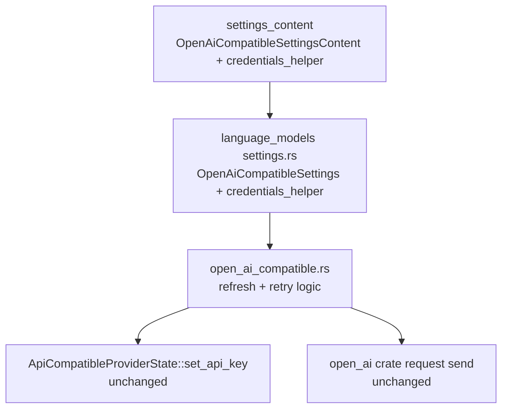

# Detailed Design: Credentials Helper for OpenAI-Compatible Providers

## Overview

Zed's OpenAI-compatible LLM providers (`language_models.openai_compatible.<id>` in
`settings.json`) authenticate with long-lived API keys stored in the system keychain
(or an environment variable). When such a key expires, every request fails with an
authentication error and the user must manually reset the key in the settings UI.

This feature adds an optional per-provider `credentials_helper` setting: an arbitrary
shell command. When a request is rejected as unauthenticated (HTTP 401), Zed runs the
helper, reads a fresh API key from its stdout, stores it exactly as if the user had
entered it in the settings UI, and retries the failed request once. The scope is
OpenAI-compatible providers only.



## Detailed Requirements

1. New optional setting `credentials_helper: Option<String>` per OpenAI-compatible
   provider, holding an arbitrary shell command line.
2. When a chat-completions or Responses request for that provider fails with an
   authentication-classified rejection (HTTP 401 → `ProviderErrorCategory::Authentication`),
   and `credentials_helper` is configured, Zed:
   - runs the command through the user's shell (`sh -c` on macOS/Linux, `cmd /C` on
     Windows) on the background executor, with a 60-second timeout;
   - requires exit status 0 and stdout containing exactly one non-empty line
     (surrounding whitespace trimmed);
   - stores the key via the existing `set_api_key` path (system keychain + in-memory
     state), so the settings UI shows the refreshed key and `is_authenticated()` is true;
   - retries the failed request once with the new key.
3. Single-flight: concurrent failed requests share one helper execution; a request
   that finds the key already refreshed by another request reuses it without running
   the helper again.
4. At most one retry per request; a second authentication failure is surfaced to the
   user unchanged.
5. Env-var-sourced keys are never refreshed (the keychain cannot override them); the
   original error is surfaced and a warning is logged.
6. Helper failures (non-zero exit, empty/multi-line output, spawn failure, timeout)
   are logged (never including the key or the helper's stdout) and the original
   authentication error is surfaced.
7. Providers without `credentials_helper` behave exactly as before.
8. The API key is never logged or included in error messages.

## Architecture Overview

No new crates, entities, or traits. Three existing layers change:



- `settings_content` gains the field (serde `Option<String>`, default `None`).
- `language_models::settings.rs` maps it into `OpenAiCompatibleSettings`.
- `open_ai_compatible.rs` gains the refresh/retry orchestration around the two request
  futures it already builds. The shared `ApiCompatibleProviderState`
  (`api_compatible.rs`, also used by Anthropic-compatible providers) is untouched.

## Components and Interfaces

### Settings

```rust
// crates/settings_content/src/language_model.rs
pub struct OpenAiCompatibleSettingsContent {
    pub api_url: String,
    pub available_models: Vec<OpenAiCompatibleAvailableModel>,
    pub custom_headers: Option<HashMap<String, String>>,
    pub credentials_helper: Option<String>,   // NEW
}

// crates/language_models/src/provider/open_ai_compatible.rs
pub struct OpenAiCompatibleSettings {
    pub api_url: String,
    pub available_models: Vec<AvailableModel>,
    pub custom_headers: CustomHeaders,
    pub credentials_helper: Option<String>,    // NEW
}
```

Both derive the same serde/schemata macros as their siblings, so the field is optional
with default `None` and merges per the existing `#[with_fallible_options]` semantics.

### Refresh orchestration (new, private to `open_ai_compatible.rs`)

```rust
fn is_authentication_rejection(error: &LanguageModelCompletionError) -> bool;

async fn run_credentials_helper(command: &str, executor: &BackgroundExecutor)
    -> anyhow::Result<String>;
// - sh -c / cmd /C, child spawned explicitly, stdout+stderr captured,
//   output trimmed, rejects empty or multi-line output,
//   60s timeout that kills the child process when it fires.

async fn refresh_api_key(
    refresh_lock: Arc<smol::lock::Mutex<()>>,  // single-flight
    state: Entity<State>,
    failed_key: Option<Arc<str>>,
    cx: &AsyncApp,
) -> anyhow::Result<Arc<str>>;
// - acquire lock; if current key != failed_key, return current (already refreshed);
// - if key is env-var sourced, bail with a logged explanation;
// - run helper, set_api_key, await, re-read and return the new key.
```

### Request-path wiring

`stream_chat_completion` and `stream_response` are restructured so the actual send is
a reusable closure `attempt(api_key) -> BoxFuture<Result<BoxStream, LanguageModelCompletionError>>`
(throttled by the same `RateLimiter` as today). The outer future becomes:

```
attempt(key).await
  → Ok(stream)                                 → done
  → Err(auth rejection) && helper configured   → refresh_api_key(...).await
                                                   → Ok(new_key) → attempt(new_key).await
                                                   → Err(log + surface original error)
  → Err(other)                                 → surface
```

The provider struct gains one field `refresh_lock: Arc<smol::lock::Mutex<()>>`
created in `OpenAiCompatibleLanguageModelProvider::new`.

## Data Models

No new persisted data. The refreshed key is stored through the existing
`CredentialsProvider::write_credentials` (system keychain, namespaced by `api_url`),
and the in-memory `ApiKeyState::load_status` becomes `Loaded(SystemKeychain)` — the
same state as a manually entered key. Settings JSON example:

```json
{
  "language_models": {
    "openai_compatible": {
      "my-provider": {
        "api_url": "https://example.com/v1",
        "credentials_helper": "pass show example-com/api-key",
        "available_models": [{ "name": "my-model", "max_tokens": 128000 }]
      }
    }
  }
}
```

## Error Handling

| Situation | Behavior |
| --- | --- |
| 401, helper configured, key from keychain | refresh + one retry; second failure surfaced |
| 401, helper configured, key from env var | log warning, surface original error |
| 401, no helper configured | surface error (unchanged) |
| Helper non-zero exit / spawn failure / timeout | log error (no key material), surface original 401 error |
| Helper prints empty or multi-line output | log error, surface original 401 error |
| Helper prints a key that is also rejected | surface the retried request's 401 error |
| No API key at all before sending | `NoApiKey` error (unchanged) |

The user-visible error for a failed refresh is the provider's own 401 message, which
is the most actionable text Zed has; helper diagnostics go to the log.

## Testing Strategy

- Unit tests (pure functions, in `open_ai_compatible.rs` alongside existing tests):
  - `is_authentication_rejection`: 401 `ProviderRejection` → true; 403/RateLimit/other
    errors → false.
  - helper output parsing: trims whitespace; rejects empty; rejects multi-line output;
    accepts a normal key string.
- Integration-style test for `run_credentials_helper` using a real shell command
  (`printf`/`echo`) to verify stdout capture, trimming, and non-zero-exit rejection —
  pattern precedent: `crates/terminal/src/pty_info.rs` runs real processes in tests.
- Settings round-trip: `OpenAiCompatibleSettingsContent` with `credentials_helper`
  deserializes and `from_settings` maps it through (mirroring how
  `custom_headers` is tested via the settings conversion).
- Manual verification: run zed against a local mock endpoint that rejects the first
  key with 401 and accepts the helper's key; confirm the request retried and the
  settings UI shows the refreshed key.

## Appendices

### Technology choices

- `smol::process::Command` (already the repo's pattern for async process spawning,
  e.g. `crates/remote/src/transport.rs`) over `std::process::Command` (blocking) or
  `tokio::process` (not used in zed).
- `smol::lock::Mutex` for single-flight: the only async mutex available in the
  existing dependency tree; one field on the provider struct, no new entities.
- Shell-based execution (`sh -c` / `cmd /C`) over argv splitting: matches git's
  `credential.helper` semantics and supports pipes/redirection in the helper command.

### Alternative approaches considered

- **Refresh proactively on a schedule or on Zed startup:** rejected; expiry time is
  unknowable, and running arbitrary commands at startup is surprising and costly.
- **A new `ApiKeySource::Helper` variant with its own cache:** rejected; reusing
  `set_api_key` keeps the keychain, settings UI, and auth state consistent with zero
  new state machines.
- **Refreshing in the agent UI layer:** rejected; the provider layer is the only place
  that sees both the 401 and the ability to retry the same request, and it keeps the
  change scoped to one file.
- **Extending the shared `ApiCompatibleProviderState` trait/struct:** rejected to
  respect the OpenAI-compatible-only scope; anthropic-compatible providers are
  untouched.

### Key constraints and limitations

- Env-var keys are out of scope for refresh (documented in Q6 of the requirements).
- The helper must be non-interactive; anything it prints beyond one line is treated
  as an error. A 60-second timeout bounds hung helpers.
- Windows uses `cmd /C`, so POSIX-only helper syntax will not work there; documented.
