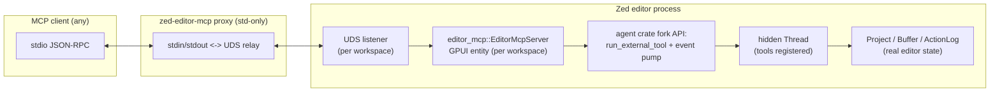
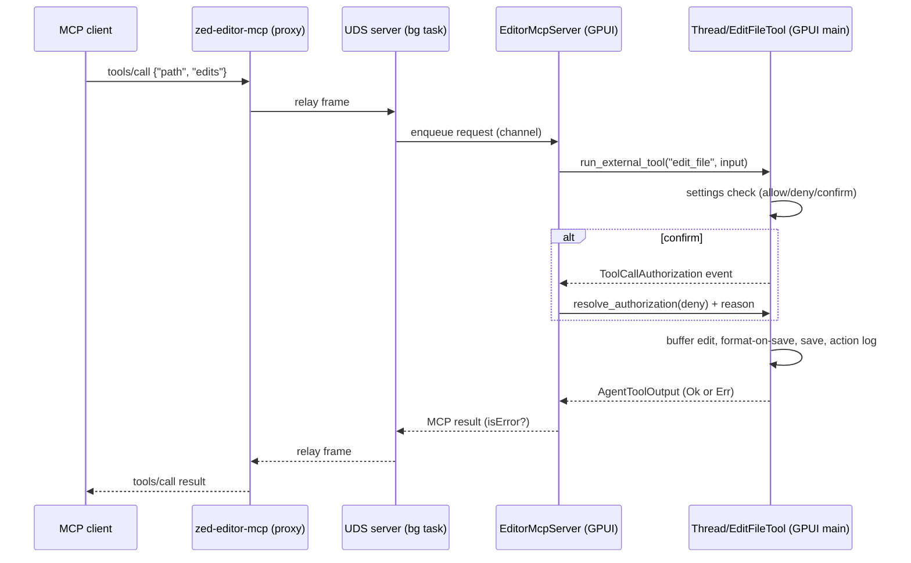

# Detailed design: in-editor MCP server delegating to Zed's agent tools

## Overview

This feature gives an external MCP client real control over the Zed editor's
built-in agent tools — `edit_file` to start — by running an MCP server **inside
the Zed editor process**. Every `tools/call` is delegated to the actual
`EditFileTool` implementation on a real `Thread` entity, so the run hits the
same code path as the built-in agent: real buffers, format-on-save, undo,
agent-location updates, the action log, and the user's existing
`agent.tool_permissions` rules. Editor coupling is the feature: a human at
the editor keeps visibility and veto rights over what an external agent does.

The server is workspace-scoped, disabled by default, enabled by a new
`agent.editor_mcp_server` settings block, and reachable over a per-workspace
Unix domain socket. A tiny standalone proxy binary lets standard stdio MCP
clients connect.

What this is explicitly **not**: a reimplementation of tool semantics on
files (a standalone mirror exists on another branch), a model-turn bridge
(the MCP caller names the tool — no LLM decides), and a general plugin system.

## Detailed requirements

Consolidated from the earlier requirements clarification (autonomous-mode
decisions; each entry records the decision, rationale, and alternatives):

1. **R1 — Real tool reuse.** A `tools/call edit_file` must execute the built-in
   `EditFileTool` on a real `Thread`. Effects must include: file/buffer changed,
   format-on-save honored, edit recorded in the action log (hence redo/undo and
   the edit review surface work), and `set_agent_location` firing.
2. **R2 — Permission fidelity.** The tool's own `authorize` flow runs untouched.
   `allow` rules in `agent.tool_permissions` permit the call; `deny` rules
   reject it with the tool's own message. A `confirm` decision is auto-denied
   with an actionable message (v1 has no interactive prompt UI for
   socket-originated calls; recorded as future work). No parallel permission
   system is introduced.
3. **R3 — Setting-gated, workspaces isolated.** New settings block
   `agent.editor_mcp_server { enabled, tools }`; `enabled` defaults to `false`;
   `tools` defaults to `["edit_file"]`. One socket + one hidden `Thread` per
   `Workspace`, keyed by a stable hash of the workspace's worktree root
   directories. Off (the default) means no socket, no thread, no background
   tasks beyond a settings check at workspace open.
4. **R4 — Standard MCP surface.** JSON-RPC 2.0, newline-delimited frames:
   `initialize`, `notifications/initialized`, `ping`, `tools/list`,
   `tools/call`, `notifications/cancelled`. `tools/list` advertises the
   allowlisted tools with their real `input_schema` and `description` from the
   `AnyAgentTool` implementations.
5. **R5 — Local-only transport.** Unix domain socket under Zed's per-user data
   directory. Windows is out of scope for v1; the transport sits behind a small
   seam so a named pipe can be added later. A std-only proxy binary
   (`zed-editor-mcp`) bridges stdio clients to the socket.
6. **R6 — Honest results.** `Ok` tool output → MCP text content from the real
   output; `Err` tool output → `isError: true` with the tool's own error text.
   Unknown tool and invalid arguments → tool-result errors naming what's wrong
   and what's available. Malformed protocol frames are dropped with a log line
   (clients that can't produce valid JSON-RPC are not our problem to fix).
7. **R7 — Liveness.** No call may hang: permission prompts are auto-resolved
   (deny); socket close or `notifications/cancelled` triggers the tool's
   cancellation watch; a disconnect mid-call cancels the in-flight run.
8. **R8 — Tested without a display.** Unit tests for framing/dispatch; GPUI
   integration tests against a real `Thread` (reuse the `agent` crate's test
   recipe) covering allow, deny, confirm-auto-deny, unknown tool, invalid
   args, and a real file edit; socket-level end-to-end test with a scripted
   client; proxy smoke test.
9. **R9 — Small fork surface.** The `agent` crate gains exactly: a public
   out-of-turn tool-run API on `Thread` (constructor for the event stream +
   registered-tool accessors + `run_external_tool`). Everything else lives in
   new crates (`editor_mcp`, `zed-editor-mcp` proxy) plus settings plumbing.
10. **R10 — Bounded resource use.** One dispatched tool per connection at a
    time; a bounded request channel (depth 16) between transport and
    dispatch; `pending` entries removed on completion and cancel (the pump
    owns cleanup where the response is sent); socket bind failures resolve
    loudly: live server from another window → log + stand down, dead file →
    reclaim + retry once. Never silently do nothing.
11. **R11 — Quiet workspace.** The hidden `Thread` must not surface in any
    UI (no `ThreadStore` registration, no sidebar, no panel item, no thread
    count effects). Implementation must verify `Thread::new` has no
    observable side effects beyond the entity; any discovered leak is
    mitigated and recorded in the plan's implementation notes.
12. **R12 — Eager thread.** The hidden `Thread` is built when the enabled
    server starts (not lazily), so `tools/list` always reflects the real
    registered tool map — no startup race between listing and calling.

## Architecture overview



Data flow for `tools/call edit_file`:



## Components and interfaces

### 1. `agent` crate — out-of-turn tool run API (fork addition, R9)

`crates/agent/src/thread.rs`:

```rust
impl Thread {
    /// Tools registered on this thread (add_default_tools), by name.
    pub fn registered_tool(&self, name: &str) -> Option<Arc<dyn AnyAgentTool>>;
    pub fn registered_tools(&self) -> Vec<Arc<dyn AnyAgentTool>>;

    /// Runs a registered tool outside a model turn, with its own
    /// event stream. Returns the run handle; the caller pumps
    /// `ToolCallEventStreamReceiver` events (see EditorMcpServer).
    pub fn run_external_tool(
        &mut self,
        name: &str,
        input: serde_json::Value,
        cx: &mut Context<Self>,
    ) -> Option<ExternalToolRun>;
}

pub struct ExternalToolRun {
    pub tool: Arc<dyn AnyAgentTool>,
    pub events: ToolCallEventStreamReceiver, // mpsc receiver wrapper (exists)
    pub stream: ToolCallEventStream,          // for resolve_authorization
    pub task: Task<Result<AgentToolOutput, AgentToolOutput>>,
}
```

Implementation mirrors the private `run_tool` sequence (restricted-mode check,
fresh mpsc + watch cancellation channel, `ToolCallEventStream::new`, initial
`status(InProgress)`, `tool.run`) without the prompt/`running_turn` coupling.
Cancellation: a per-run `watch::Sender<bool>` stored in the run handle, exposed
as `cancel()`. `ToolCallAuthorization` events are answered by the pump (below),
never left dangling (R7). The stream's `thread` field points at this `Thread`
so `is_subagent`, grants persistence etc. behave as usual.

### 2. `editor_mcp` crate (new workspace member)

```rust
pub struct EditorMcpServer {
    workspace: WeakEntity<Workspace>,
    thread: Option<Entity<agent::Thread>>,     // hidden, lazy
    socket_path: PathBuf,
    settings: EditorMcpServerSettings,          // enabled + tools allowlist
    incoming: smol::channel::Receiver<McpRequest>, // bg -> main
    pending: HashMap<RequestId, PendingRun>,   // for cancellation
    _subscription: gpui::Subscription,          // settings changes
    _tasks: (Task<()>),                         // accept loop + pump
}
```

Responsibilities:
- **Lifecycle.** Constructed at workspace open when the setting is enabled
  (registered via a `workspace::register_workspace_observer`-style hook in
  `zed` boot, consistent with how other per-workspace entities start). Builds
  the hidden `Thread` **eagerly** at server start (R12). Socket removed on
  workspace close. On bind failure: probe-connect; if a live server answers,
  log "another Zed window already serves MCP for this workspace" and stand
  down (never steal); else remove the dead socket file and retry once (R10).
- **Transport.** A background accept loop (smol `Async<UnixListener>` in a
  `cx.background_spawn`ed task) queues `McpRequest { conn_id, raw frame }`
  through a **bounded channel (depth 16)**; each connection has at most one
  dispatched tool at a time (R10) — this pair is the backpressure mechanism.
  Per-connection responses go back through a per-connection bounded channel
  the connection task drains to the socket. One reader task per connection;
  writes are serialized by a per-connection writer task.
- **Protocol.** A pure module (`protocol.rs`) frames/validates JSON-RPC:
  parse, route by method, build responses. Fully unit-tested without GPUI
  (R8).
- **Dispatch (`tools/call`).** On the main thread: validate tool allowlist →
  `thread.run_external_tool` → spawn a background pump that drains the run's
  event receiver: `ToolCallAuthorization` → auto-deny with the R2 message and
  also send a `resolve_authorization(Deny outcome with reason selected via
  SelectedPermissionOutcome)`; ignore update events; on task completion,
  build the MCP result (`Ok` → text parts of `llm_output`; `Err` → `isError`
  with the same text). Timeout: none needed — every blocking seam resolves
  because (a) allow/deny are synchronous settings lookups, (b) confirms are
  auto-denied, (c) tools select on cancellation. Exceptions cancel on client
  disconnect by watching socket closure.
- **Cancellation.** `notifications/cancelled { requestId }` and connection
  closure map to `PendingRun.cancel()` → the run's watch sender → tools'
  `cancelled_by_user` futures. The pump deletes the `pending` entry in the
  same place it sends the response frame (and on cancel completion), so the
  map never holds a finished run (R10).
- **Settings changes.** Observing `SettingsStore`: enabling after start opens
  the socket; disabling closes it and cancels in-flight calls. Tool allowlist
  changes apply to subsequent calls.

### 3. Settings (R3)

`crates/settings_content/src/agent.rs`:
```rust
#[derive(Clone, Debug, Default, Serialize, Deserialize, JsonSchema)]
pub struct EditorMcpServerContent {
    /// Enable the in-editor MCP server for this workspace. Default: false
    pub enabled: Option<bool>,
    /// Built-in agent tool names served over MCP. Default: ["edit_file"]
    pub tools: Option<Vec<Arc<str>>>,
}
```
Compiled in `crates/agent_settings` to `EditorMcpServerSettings { enabled: bool,
tools: Vec<String> }` with defaults `false` / `["edit_file"]`.

### 4. `zed-editor-mcp` proxy (std-only crate)

`--socket PATH` (or `ZED_EDITOR_MCP_SOCKET`). Relays stdin lines to the socket,
socket lines to stdout, verbatim; exits 0 on clean EOF either side; on connect
failure prints "Zed editor MCP socket unavailable at PATH — is Zed running with
`agent.editor_mcp_server.enabled = true` for this workspace?" to stderr and
exits 1. No parsing beyond line framing (the protocol layer owns JSON).

### 5. Wiring

`crates/zed` boot (or the workspace crate's init where other workspace-scoped
services start): register the observer that instantiates `EditorMcpServer` per
workspace when enabled. No UI elements in v1.

## Data models

- `McpRequest { conn: ConnId, frame: String }` (bg → main).
- `McpResponseEnvelope { conn: ConnId, frame: String }` (main → bg writer).
- MCP JSON shapes per the protocol module (initialize result, tools/list entry
  `{ name, description, inputSchema }`, tools/call result
  `{ content: [{type:"text", text}], isError? }`).
- `PendingRun { tool_name, run: ExternalToolRun }`.
- No persistent state: nothing touches `db.rs`; the hidden thread lives in
  memory only and is not listed in the threads sidebar (it is a plain `Thread`
  entity never registered with `ThreadStore`).

## Error handling

- **Path A — protocol errors** (unparseable frame, unknown method): JSON-RPC
  error response with id if available; else a log line. Idempotent, no state.
- **Path B — request-level errors** (unknown tool, invalid args): a `tools/call`
  *result* with `isError: true` and a descriptive text, so calling agents can
  self-correct (mirrors how the built-in agent handles bad tool input).
- **Path C — tool errors** (`Err(AgentToolOutput)`): `isError: true`, the
  tool's own error text (e.g. the familiar "Failed to edit ... not unique ...").
- **Path D — interactive permission prompts**: auto-deny + text explaining how
  to pre-authorize (R2), also logged at INFO for the human to notice.
- **Path E — crashes/panics**: `ToolCallEventStreamReceiver` drops, so a welded
  pump must never `.await` without a completion source; the run task's own
  catch guarantees a response is always sent. Socket accept errors log and
  continue (the workspace may outlive a broken socket path).
- **Path F — stale sockets**: startup best-effort `remove_file` when the path
  is dead; connect-probe to avoid stealing a live socket.

## Testing strategy

1. **Protocol unit tests** (`editor_mcp::protocol`): framing parse/build for
   every method, error shapes, cancel routing. No GPUI.
2. **GPUI integration tests** (`editor_mcp`): build a real `Project` +
   `Thread` (recipe from `crates/agent/src/tools/edit_file_tool.rs:3201`),
   drive `EditorMcpServer` dispatch directly (not through sockets):
   - allow-rule edit: file content changes, output text contains
     `Edited ... successfully`
   - deny-rule: isError with deny-reason text
   - confirm-default: isError with the pre-authorize message
   - unknown tool / invalid args: isError with enumerations
   - cancellation: cancel before completion returns promptly.
3. **Socket end-to-end test** (`editor_mcp`): scripted client over a temp UDS:
   initialize → tools/list → tools/call (allow) → assert reply and file state.
4. **Proxy smoke test**: spawn proxy against the test socket, relay frames.
5. **Agent-crate API tests** (`agent`): `run_external_tool` runs `edit_file`
   against a test project; authorization events round-trip; cancellation
   stops a long-running tool (`deny` on an unopened prompt path).
   These mirror the existing `#[gpui::test]` style in `edit_file_tool.rs`.

Manual/QA checklist (documented in README): enabled setting + allow rule →
connect real client via proxy → edit lands with undo + cursor indicator.

## Appendices

### Technology choices

- **Hand-rolled JSON-RPC vs `rmcp`:** ~200 lines of well-tested protocol code
  vs a new editor dependency. Chosen: hand-rolled, because the whole point is
  a minimal, auditable surface and the MCP subset is small; `rmcp` also drags
  in tokio conventions foreign to the editor's smol stack.
- **smol `Async<UnixListener>` vs std threads:** smol is already the editor's
  runtime; `Async` wrappers give cancellation-friendly accept/read loops with
  `background_spawn`. Chosen: smol (std threads kept for the proxy binary).
- **Per-workspace UDS vs single global socket:** workspaces have distinct
  projects; a global socket would force a "which project did you mean"
  into the protocol. Chosen: per-workspace path under
  `paths::data_dir()/editor_mcp/<sha256(worktree_roots)>.sock`.

### Existing-solutions analysis

- **PR #2 (rejected)** put the MCP server in a separate binary and invented a
  custom socket protocol into a patched Zed. This design inverts it: MCP
  terminates in-editor (one process, one trust domain), no custom protocol
  layer, no review-session apparatus.
- **Upstream `zed --agent` does not exist in this fork**; ACP is client-side
  only (Zed hosts *external* agents). No prior art for outbound exposure of
  built-in tools; the `agent` API addition in this design is the smallest
  seam the research found.
- **Standalone `zed-edit-file-mcp` (branch `vibe/zed-edit-file-mcp-8dff25`)**:
  mirrors semantics on disk; no editor integration. Complementary, not
  replaced: this design covers the "real editor state" case the mirror cannot.

### Alternative approaches considered

- **Drive a model turn** on a visible thread (the MCP request becomes a user
  prompt): rejected — non-deterministic (the model may refuse or improvise)
  and wasteful; the requirement is direct tool invocation.
- **Direct `EditFileTool::new` with a stub `Thread`:** rejected — stubs drift
  from real `Thread` behavior (permissions, grants, subagent checks read the
  entity), breaking R1/R2 fidelity silently.
- **Interactive confirmation routed to Agent Panel:** deferred from v1 — the
  prompt pipeline (`NativeAgentConnection` → ACP session events) assumes
  session turns; a fake session risks hangs, the worst failure mode. The
  auto-deny is explicit and reversible by settings; the `ExternalToolRun` API
  keeps a clean seam to add prompt plumbing later.
- **TCP/SSE transports:** rejected (research: local-only transport).

### Key constraints and limitations

- GPUI entities are main-thread-only; all dispatch crosses a background/main
  seam.
- `confirm`-class calls always fail until the user writes allow rules; this is
  the deliberate trust model, not a defect.
- Windows support deferred (named-pipe transport needed).
- Tool runs serialize on the editor main thread like all editor work.

### Design Revision 1 (after design review, round 1)

Incorporated from the ponytail review (reviews/round-1-design.md):
- R10 added: bounded incoming channel, one in-flight tool per connection,
  `pending` cleanup owned by the pump, loud socket-bind tiebreak/reclaim.
- R11 added: quiet-workspace guarantee for the hidden Thread, with an
  explicit implementation-time verification obligation.
- R12 added: eager Thread creation (overturns the earlier "lazily at first
  use" wording in idea-honing Q3) to eliminate the tools/list startup race.
