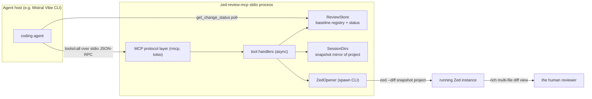
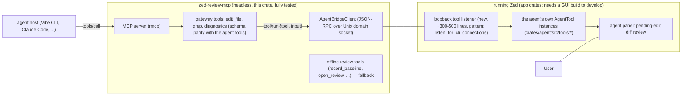

# Zed Review MCP — detailed design

## Overview

`zed-review-mcp` is a new headless Rust crate in the Zed workspace that gives external
coding agents (Mistral Vibe CLI, Claude Code, opencode, …) Zed's asynchronous change-review
workflow, closing the main gap in
[Zed discussion #46388](https://github.com/zed-industries/zed/discussions/46388): Zed today
has no MCP *server* surface, so external agents cannot surface their pending changes as
rich diffs inside Zed.

The tool is an MCP server over stdio, spawned by the agent host like any MCP server. It
implements the change-review protocol proven by
[Aletheia](https://github.com/demiourgoi/epinoia/blob/main/aletheia/README.md), with one
deliberate divergence: instead of bundling a web diff UI, the review GUI is **Zed itself**.
The server keeps on-disk baseline snapshots and opens Zed's native multi-file diff view
through the already-existing `zed --diff <left> <right>` CLI capability:

1. The agent calls **`record_baseline(paths)`** before editing; the server snapshots each
   file's content into a session snapshot directory mirroring the project layout.
   Non-existent files are recorded as *marked for creation* (no snapshot content).
2. The agent edits files on disk normally. Linters, formatters and tests run against real
   files at any time; the review diff is **live** — it always compares baseline vs. the
   current working tree.
3. The agent calls **`open_review()`**; the server runs
   `zed --diff <session-snapshot-dir> <project-root>`. Zed's CLI expands directory pairs
   into per-file diffs (empty stubs for added/removed files) and shows a single
   multi-buffer diff view in the running editor (or boots one). The user reviews with
   Zed's rich UI, can edit the proposed content there, and runs CI tools before deciding.
4. Decisions: **`approve(paths)`** adopts the working tree (removes baselines);
   **`reject(paths)`** restores the baseline content on disk and removes baselines.
   A file is under review exactly while it has a baseline entry; a new round re-records.
5. **`get_change_status()`** reports live per-file drift at any time; nothing ever blocks
   the agent conversation.

Two supporting tools complete the picture: **`edit(file_path, old_string, new_string,
replace_all)`** — an opt-in, baseline-aware replacement for the CLI agent's built-in edit
tool whose first edit of a file automatically records the baseline — and
**`open_paths(paths)`** — basic IDE integration that opens files in the running Zed.

The entire feature is a new crate `crates/zed_review_mcp` with a binary
`zed-review-mcp`. No GUI crate is modified: every component is buildable and testable
headless (`cargo test -p zed_review_mcp`), which is a hard requirement of the development
environment (it has none of the Linux desktop libraries Zed's `gpui`-dependent crates
need).

## Detailed requirements

Consolidated from the idea-honing decisions:

| # | Requirement |
|---|-------------|
| R1 | MCP server over stdio, usable from any standard MCP client (Vibe CLI, Claude Code, opencode) |
| R2 | `record_baseline(paths)` snapshots files before editing; missing files are marked for creation; re-recording a file that already has a baseline is an error naming the path |
| R3 | `open_review()` opens Zed's multi-file diff of baseline vs. working tree via `zed --diff`; must not fail the tool call when a running Zed opens it asynchronously |
| R4 | `get_change_status()` reports per-file review kind (modified / created / removed / unchanged) computed live from disk |
| R5 | `approve(paths)` adopts the working tree and ends review for those paths; `approve(None)` approves all |
| R6 | `reject(paths)` restores pre-change content on disk (and deletes working files whose baseline was "marked for creation") and ends review; `reject(None)` rejects all |
| R7 | `edit(file_path, old_string, new_string, replace_all)` performs an exact, unique-match replacement; first successful edit of a file records the baseline automatically; failed edits leave no baseline side effects |
| R8 | `open_paths(paths)` opens files in the running Zed |
| R9 | Trusted-root confinement: all file arguments resolve (after symlinks) inside the trusted root (git worktree root of the startup working directory, falling back to that directory); violations and missing baselines are tool errors naming the offending path |
| R10 | Only UTF-8-8 text files are reviewable; binary files and directories produce clear tool errors |
| R11 | Baselines must be on-disk real files (required by `zed --diff`); they live in a per-session snapshot directory; a fresh server starts an empty review |
| R12 | Sessions are single-process and loopback-only: the server listens on nothing, spawns only the local `zed` executable, and never contacts the network |
| R13 | Every tool result is plain text the agent can read; tool errors use MCP `isError` with actionable messages |
| R14 | The crate must build headless and be fully covered by `cargo test -p zed_review_mcp` in CI (unit + integration incl. a fake-`zed` binary and a stdio end-to-end run) |

Future extensions (not in scope, documented): in-editor IPC bridge into Zed's agent-panel
review UI, diagnostics queries, active-editor context, branch-diff review.

## Architecture overview



## Components and interfaces

### `ReviewStore` (`src/review_store.rs`)

Owns the baseline registry. **State on disk**: the session directory contains

```
<session_dir>/trusted-root                     # one-line absolute path of the trusted root
<session_dir>/baselines/<relative path>         # snapshot content, mirroring project layout
<session_dir>/creations/<relative path>         # empty marker files for marked-for-creation files
<session_dir>/review-baseline-view/<relative>   # baseline side of the review diff view
<session_dir>/review-work-view/<relative>       # working-tree side of the review diff view
```

A file is under review **iff** a corresponding file exists under `baselines/` (it existed
snapshot) **or** `creations/` (it was marked for creation). Keeping creation markers in
their own tree (rather than encoding them as zero-byte snapshots) removes the ambiguity
with genuinely empty files: rejecting an approved empty file restores original content
instead of deleting it, and recording an empty file that later receives content is
reported as `modified`, not `created`.

`open_review` materializes a fresh pair of review views per call — `review-baseline-view`
mirrors the baseline of every changed file, `review-work-view` mirrors its current
working content — and opens `zed --diff <review-baseline-view> <review-work-view>`. Using
the session views as **both** sides (instead of the project root as the right side)
matters: the Zed CLI expands directory pairs into per-file diffs and stubs right-only
files with empty left files, so pairing against the whole trusted root would display the
entire repository as changes.

Public API (all fallible, all errors carry the offending path):

- `ReviewStore::start(trusted_root, session_dir)` → creates dirs; refuses to start over
  an existing `baselines/` tree that contains anything (a fresh server means a fresh
  review; prevents mixing baseline trees).
- `record_baseline(&self, absolute_path) -> RecordOutcome` — `Recorded` (existed:
  content copied as-is, byte-preserving) or `MarkedForCreation` (did not exist:
  zero-byte snapshot created). Error if already under review; error if outside trusted
  root or not a regular UTF-8 file.
- `status(&self) -> Vec<FileStatus>` — for every baseline entry, live kind:
  `unchanged` (bytes equal), `modified` (bytes differ), `created` (baseline zero-byte +
  working file exists — possibly still empty), `removed` (working file gone while
  baseline has content). Sorted by path.
- `approve(&self, path)` — verify the entry exists, then delete the snapshot file.
  Prunes now-empty snapshot parent dirs.
- `reject(&self, path)` — verify entry exists; if the snapshot has content, copy it back
  over the working file (atomic write: write temp in the same dir, then rename); if it is
  a zero-byte *creation* snapshot, delete the working file. Then remove the snapshot.
- `baseline_path_for(&self, absolute_path)` — location of the snapshot (used by `edit`
  and `open_review`).

Concurrency: all methods take `&self`; interior state is a `std::sync::Mutex<HashMap<...>>`
only for *session bookkeeping* if needed. The actual baseline files on disk are the
source of truth, so MCP-level serialization (rmcp processes client requests sequentially)
is sufficient; the mutex guards multi-step read-modify-write sequences (e.g., check-then-
record) so a future concurrent tool executor cannot corrupt state.

### Diff computation for `status`

Status is byte comparison (`read` + `==`), not a text diff — the tool report says
*whether* a file drifted. Producing hunk-level diffs is Zed's job (the diff UI), not ours;
duplicating diff rendering would violate lean. `similar`/`streaming_diff` are therefore
**not** dependencies of this MVP: byte equality answers every protocol question
(R4, R7 uniqueness is checked via `str::match_indices`).

### `ZedOpener` (`src/zed_opener.rs`)

- `resolve()` — resolution order: `ZED_PATH` env var (must exist), then `zed` on `PATH`
  via `which`-style lookup (`PATH` split + exists checks; no extra dependency); error
  names both options.
- `open_diff(left_dir, right_dir)` and `open_paths(paths)` spawn the executable with
  `Stdio::null()` for stdin/stdout and captured stderr; the child is **not waited on**
  beyond spawn success —;z ed detaches. Errors: spawn failure, non-zero immediate exit
  (only observable via the CLI's own stderr), missing paths. Failure yields a tool error
  telling the user to start Zed or check `ZED_PATH`.
- Tests inject a fake `zed` script on `PATH` that records its arguments to a file.

### MCP protocol layer (`src/zed_review_mcp.rs`)

`rmcp` 3.11 with features `server`, `transport-io`, `macros`. `ReviewServer` implements
`ServerHandler` via `#[tool_router]`; the `#[tool]`-annotated methods are the seven tools
in Detailed requirements R2–R8. Tool args are plain structs deriving `JsonSchema`
(schemas auto-derived by rmcp). Binary `main.rs`: resolve working dir → trusted root →
session dir → build store → `serve_server(stdio())`. Normal shutdown on stdin EOF cleans
up the session dir when the server created it.

### Session directory lifecycle (`main.rs`)

Default `<std::env::temp_dir()>/zed-review-mcp-<pid>-<unix-millis>`, overridable by
`--session-dir` / env `ZED_REVIEW_MCP_SESSION_DIR` (used by tests and embedders). The
server never removes or writes anything outside `session_dir` (snapshots) and the
trusted root (reject restores, `edit` writes). Cleanup on EOF only deletes
`session_dir`; crash leftovers are inert per-OS-temp garbage.

### Trusted root resolution (`src/trusted_root.rs`)

`git rev-parse --show-toplevel` from the current working directory via
`std::process::Command`; on any non-zero exit or missing git, fall back to the current
working directory. The resolved root is canonicalized (`std::fs::canonicalize`) and
recorded in `<session_dir>/trusted-root` for inspectability.

Path safety helper `confine(path, root)`: canonicalize the path's nearest existing
ancestor (needed because the file may not exist yet — created files have no canonical
form), or `fs::canonicalize(path)` when it exists; verify the result starts with the
canonical root; return the path as-is (not yet existing) when the check passes. This is
the same symlink-proof scheme Aletheia uses.

## Data models

```mermaid
classDiagram
class RecordOutcome { <<enum>> Recorded | MarkedForCreation }
class FileKind { <<enum>> created | modified | removed | unchanged }
class FileStatus {
  +String path        // project-relative, forward slashes
  +FileKind kind
}
class SessionDirs {
  +PathBuf session_dir     // trusted-root file lives here
  +PathBuf baselines       // session_dir/baselines
}
class ToolError { +String message } // rendered as MCP isError text, always names path
```

Tool argument schemas (JSON, auto-generated; shown for the agent-facing contract):

```jsonc
record_baseline { "paths": string[] }                   // absolute
open_review     {}                                        // no args
get_change_status {}                                      // no args
approve         { "paths": string[] | null }              // null/omitted = all
reject          { "paths": string[] | null }             // null/omitted = all
edit            { "file_path": string, "old_string": string,
                  "new_string": string, "replace_all": boolean? }
open_paths      { "paths": string[] }                    // absolute
```

Reply payloads are human-readable text (the agent prints/shows them); each mentions the
affected paths and, for `record_baseline`/`edit`, tells the agent to call `open_review`
for the user. This mirrors the Aletheia `url` reply field (we return the action instead
of a URL — the GUI is the user's editor).

## Error handling

- All fallible operations return `anyhow::Result`; layers add context; tool handlers
  convert errors into MCP tool results with `isError: true` and a message that always
  names the offending path — agents act on named paths (R9, R13).
- `edit` semantics (mirrors Vibe CLI built-in): unique `old_string` match required unless
  `replace_all`; `old_string == new_string` rejected; zero matches rejected; failing
  validation must leave **no** baseline side effect (baseline recorded only after the
  edit is fully applied — record happens before write? No: read → validate → record
  baseline of the *pre-edit* content → write. On write failure the baseline entry may
  remain; that is safe: it points at the pre-edit content and only helps a subsequent
  `reject`. Restoring from it is idempotent).
- `reject` restores via temp-file + rename so a crash mid-write cannot truncate a user
  file beyond recovery (worst case the temp file remains).
- Server startup errors (no trusted root, session dir collision) abort the process with
  a clear stderr message — a misconfigured server must not half-run.
- IO errors are never swallowed: every `Result` is either propagated, `context`-wrapped,
  or (for cleanup paths) logged to stderr as `zed-review-mcp: cleanup: ...`.

## Testing strategy

1. **Unit (review_store)**: record existing/missing file; re-record error names path;
  kind transitions (record → unchanged, edit → modified, create → created, delete →
  removed); approve/reject lifecycle and dir pruning; confinement cases (outside root,
  symlink escape, binary file, directory path); reject round-trip mtime content;
  creation-reject deletes working file.
2. **Unit (trusted_root, opener)**: git worktree vs. non-git fallback (real temp git
  repo); env var precedence; fake `zed` on PATH records exact args for `open_diff` /
  `open_paths` (integration-style, no GUI needed).
3. **Unit (edit tool)**: unique/ambiguous/zero matches, replace_all, equality rejection,
  automatic first-edit baseline, failed edit leaves no baseline, mutates disk exactly.
4. **Integration (MCP layer, in-process)**: build the `ReviewServer` and drive a full
  conversation through rmcp's `serve_server`/client pair **in-memory over duplexed
  channels** (rmcp supports ` RwPair`/duplex streams, as used by its own tests): initialize →
  list tools (assert names/schemas) → call each tool against a temp project → assert
  replies and disk state. This covers protocol correctness without process orchestration.
5. **End-to-end (binary, spawned)**: launch `zed-review-mcp` as a child process with a
  piped stdin/stdout, perform the JSON-RPC handshake and a `record_baseline` → `edit` →
  `get_change_status` → `reject` round, verifying replies and that processes shut down
  on EOF. Guards the binary wiring (main.rs, stdio transport) that (4) cannot reach.

CI surface: `cargo test -p zed_review_mcp`, `cargo clippy -p zed_review_mcp --all-targets`,
`cargo fmt --check` — all runnable headless.

## Appendices

### Technology choices

| Choice | Alternatives | Why |
| --- | --- | --- |
| `rmcp` 3.11 (official Rust SDK) | hand-written JSON-RCP; `mcp-server` crates | User-suggested; spec-correct initialize/handling, macro tool routing, auto schemas; tokio already pinned in workspace |
| Baselines as on-disk snapshot dir | in-memory baselines + web UI | `zed --diff` requires real files; zero new UI code; state inspectable; survives inspect/restart |
| Byte-equality status | `similar`/`streaming_diff` hunks | the protocol only needs drift + kind; Zed renders the rich diff |
| Spawn `zed` CLI | in-app Unix-socket bridge | GUI crates unbuildable in dev env / CI risk; CLI path is shipped, maintained and cross-platform; in-app bridge documented as future path |
| git root via `Command` | `crates/git` dependency | one call, no workspace-coupling, headless-testable |
| session dir in OS temp | Zed data dir | shorter paths (IDE diff tabs show them), auto-GC on reboot, no risk of polluting user data on crash |

### Research findings that shaped the design

- `zed --diff` directory-pair expansion creates empty stubs for one-sided files — this is
  what makes "marked for creation" representable as a zero-byte baseline and renders
  added/removed files correctly in the multi-diff view.
- Hosts may forbid their built-in edit tool (Vibe `disabled_tools = ["edit"]`) to force
  edits through the baseline-aware tool; documented in the README.
- Aletheia's rule set (record-before-edit, decisions-shrink-baseline, UTF-8 only, path-
  naming errors) is battle-tested with real agents; adopted verbatim to make
  `zed-review-mcp` a familiar drop-in.

### Alternative approaches considered

1. **Full in-app MCP bridge** (Unix socket inside the `zed` crate, wiring into workspace /
   buffer_diff / agent panel): strongest GUI integration, but unverifiable in this
   environment and a large footgun; deferred.
2. **Bundled web GUI (Aletheia port)**: duplicates the product the user asked to replace
   with Zed's review UI; rejected.
3. **Read-only editor-context tools first** (choen Patchbay-style): useful but not the
   named flagship use case; only `open_paths` kept in MVP as the minimal IDE tie-in.

---

# Revision 2 — the agent tool bridge (primary architecture)

Raised in review: instead of re-implementing an Aletheia-style baseline protocol inside
zed, expose the Zed agent's own tools so external agents reuse the exact same code paths
— including `edit_file`'s pending-edit review diff. Investigation conclusions
(`research/agent-tool-bridge.md`):

- The agent's tools are in-app `AgentTool` implementations bound to the live
  `Project`/`Thread` entity graph, so extracting them into a shared `gpui`-free library
  is a core re-architecture, not a refactor. But in-process reuse needs no extraction at
  all: the running Zed can construct the agent's own tool objects
  (`GrepTool::new(project)`, `EditFileTool::new(project, thread, …)`) and `run` them.

## R2 architecture



- **Wire protocol**: newline-delimited JSON-RPC 2.0 over a Unix domain socket at
  `ZED_AGENT_BRIDGE_SOCKET` (env; default `<paths::data_dir()>/zed-agent-tool-bridge.sock`,
  portability via named pipes on Windows deferred). Method `agent_tool/run` with
  `{"tool": "<AgentTool::NAME>", "input": <tool input JSON>}`; result renders the tool
  output as MCP-style content `{"content":[{"type":"text","text":...}]}`; errors are
  JSON-RPC errors that the gateway surfaces as MCP `isError` text naming the tool.
- **Schema parity**: each gateway tool mirrors the agent tool's `Input` struct
  (same field names, same schema doc-comments, schemars-derived), so agents already
  trained on Zed's tool list need no changes.
- **Session semantics**: the app-side listener binds a bridge session to the active
  workspace/project; `edit_file` pending edits land in the agent panel exactly like the
  built-in agent's edits, giving the identical rich-diff review (review → edit →
  approve/reject) with CI run against real files — the reviewer's requested behavior.
- **Offline fallback**: the v1 baseline-review tools (record_baseline / edit /
  open_review / approve / reject / open_paths / get_change_status) remain for
  conversations where Zed is not running or the app bridge has not landed; the server
  README and tool descriptions present them as fallback, not the primary flow.
- **App-side piece**: new module in `crates/zed` following `listen_for_cli_connections`
  (`open_listener.rs:417`): Unix-socket accept loop, one request at a time; resolve the
  active workspace → `Project`/`Thread`; dispatch `tool` via the registry in
  `crates/agent/src/tools.rs` (`ALL_TOOL_NAMES`); construct the tool (matching
  `EditFileTool`'s thread+permission-agent wiring in `thread.rs`); run
  `AgentTool::run`; serialize `Self::Output` (it is `Serialize`, and its MCP content
  text is what the gateway returns). Permission-gated tools route through the same
  `ToolPermissionsAgent` the agent panel uses, confirming each call in the panel UI.

## R2 value and phasing

Phasing from the research matrix: (1) this PR — headless protocol + gateway
(`grep`, `diagnostics`, plus `edit_file`/`read_file`/`write_file`-family contracts) with
full protocol tests against a fake bridge; (2) the app-side listener + bridge session on
a machine that can build the app crates (this environment cannot compile
`gpui`-dependent crates; verified and documented, cf. PR #1); (3) remaining tools by
phase (terminal, LSP tools, conversation tools — see the research matrix for per-tool
effort).

Everything in (2) is mechanical against the protocol and tool registry; no editor-domain
decisions remain open except the permission-confirmation UX for external callers.
