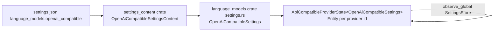
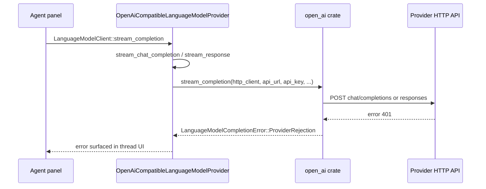
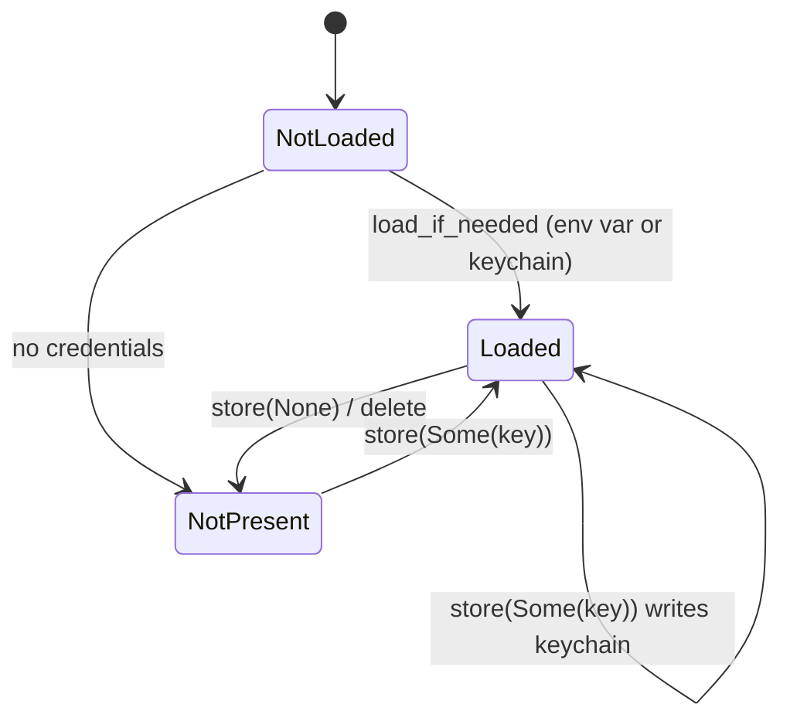

# Architecture (LLM provider subsystem)

## Settings pipeline

- `settings_content` defines the user-facing JSON shape (serde + JsonSchema, `#[with_fallible_options]`).
- `language_models::settings.rs` converts content structs into resolved settings in
  `AllLanguageModelSettings::from_settings`.
- `ApiCompatibleProviderState::new` observes the global settings store and calls
  `update_settings` when the merged settings for the provider id change.

## Request lifecycle

- The api key is read from `state.api_key_state.key(api_url)` at request time
  (`crates/language_models/src/provider/open_ai_compatible.rs:139-159`).
- There is no retry or credential-refresh step today: a 401 fails the request and the
  user must reset the key in the settings UI.

## API key state machine

- Env-var keys cannot be overwritten from Zed (`ApiKeyState::store` returns an error).
- Keychain keys are namespaced by `api_url`.
