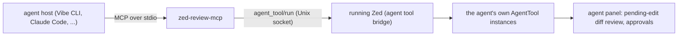

# zed-review-mcp

> [!IMPORTANT]
> Remove this line to confirm you've reviewed this PR before submitting.

`zed-review-mcp` is an MCP server (stdio) that gives external coding agents — Mistral Vibe
CLI, Claude Code, opencode, anything that speaks MCP — access to **Zed's own agent
tools**, per [Zed discussion #46388](https://github.com/zed-industries/zed/discussions/46388):
`edit_file` edits run through the editor's exact agent code path, so pending edits appear
in **Zed's agent panel** with the same rich review diff the built-in agent has — review,
edit, run linters/CI, then approve or reject — and `grep`/`diagnostics` search and report
exactly like the built-in agent's tools.

## Architecture: the agent tool bridge

The Zed agent's tools live in `crates/agent/src/tools/*` and are bound to the live
editor state (`Project`, buffers, LSP, the pending-edits session), so they cannot be
extracted into a shared library. Instead this server is a **gateway**:

1. The running Zed (this fork, with the app-side listener) accepts `agent_tool/run`
   requests on a local Unix domain socket — the *agent tool bridge* —
   (`ZED_AGENT_BRIDGE_SOCKET`, default `$ZED_DATA_DIR/zed-agent-tool-bridge.sock`) and
   executes them by constructing the agent's own tool objects
   (`GrepTool::new(project)`, `EditFileTool::new(...)`, `DiagnosticsTool::new(project)`)
   through the same registry the agent panel uses. `edit_file` pending edits surface in
   the agent panel's review UI — the identical review workflow, because it is the
   identical code.
2. `zed-review-mcp` exposes those tools over MCP with **schema parity**: the gateway
   tools mirror the agent tools' input schemas (`EditFileToolInput`, `GrepToolInput`,
   `DiagnosticsToolInput` — same fields, same semantics).



The protocol, gateway and tool schemas are fully implemented and tested here against a
fake bridge. The app-side listener (~300–500 lines in `crates/zed`, following the
existing `listen_for_cli_connections` pattern) is specified in the design document; it
must be landed from a machine that can build Zed's `gpui`-dependent app crates (this
crate deliberately stays headless so everything else builds and CI-tests anywhere). On a
Zed without the bridge, the bridge tools return an actionable error explaining what to
do.

## Bridged tools (primary)

| Tool | Upstream code path |
| --- | --- |
| `edit_file(path, edits[{old_text, new_text}])` | `agent::EditFileTool` — pending edits + review diff in the agent panel |
| `grep(regex, include_pattern?, offset?, case_sensitive?)` | `agent::GrepTool` — project-wide regex search over live buffers |
| `diagnostics(path?)` | `agent::DiagnosticsTool` — live LSP diagnostics, project summary when path omitted |

The tool-coverage plan for the rest of the documented tool list
(`read_file`, `write_file`, `list_directory`, `find_path`, path tools, `terminal`,
LSP tools, `fetch`, conversation tools) — per-tool mechanism and phasing — is in the
design document (research matrix: which tools are trivial/easy/medium to expose).

## Offline review fallback

When Zed is not running (or its build has no bridge), external agents can still get a
reviewable change flow on disk, Aletheia-style:

1. `record_baseline(paths)` before editing (or `edit(...)`, which auto-records the
   baseline on first use) — snapshots before editing.
2. `open_review()` — opens Zed's native multi-file diff of the drift via the existing
   `zed --diff` CLI (works with any current Zed build, no bridge needed).
3. `get_change_status()` live drift report; `approve(paths)` / `reject(paths)` record the
   decision (omit `paths` for everything); `open_paths(paths)` opens files in Zed.

A file is under review exactly while it has a baseline. Every path must be absolute and
inside the trusted root (the git worktree root of the server's working directory). Only
UTF-8 text files are reviewable. Errors name the offending path.

## Running it

From a checkout (the crate is part of the Zed workspace):

```sh
cargo install --path crates/zed_review_mcp
```

The offline tools require the `zed` executable (point `ZED_PATH` at it when it is not on
your `PATH`); the bridged tools additionally require a running Zed with the agent tool
bridge.

Client configuration example (Mistral Vibe CLI, `.vibe/config.toml`):

```toml
[[mcp_servers]]
name = "zed"
transport = "stdio"
command = "zed-review-mcp"

# optional, so edits happen through the reviewable paths instead of the built-in tool:
disabled_tools = ["edit"]
```

Environment: `ZED_AGENT_BRIDGE_SOCKET` (bridge socket path),
`ZED_REVIEW_MCP_SESSION_DIR` / `--session-dir` (offline baseline snapshots, default
`$TMPDIR/zed-review-mcp-<pid>`, removed on shutdown), `ZED_PATH` (Zed executable for the
offline tools). The server listens on nothing: loopback-only by construction.

## Development

```sh
cargo test -p zed_review_mcp      # unit + protocol + bridge + binary end-to-end tests
cargo clippy -p zed_review_mcp --all-targets
cargo fmt --check
```

The crate is intentionally headless (no `gpui`): the bridge protocol and MCP gateway are
developed and tested here; the app-side listener runs the editor's own tool machinery
and follows the design document's specification. Future extensions: remaining agent tools
by phase, in-editor approve/reject buttons for bridge sessions, diagnostics streaming.
